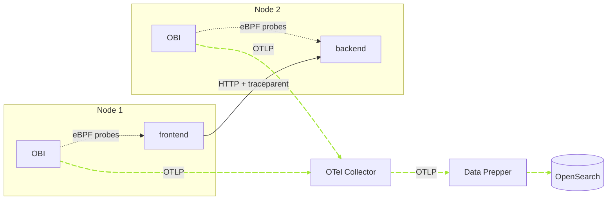

[OpenTelemetry eBPF Instrumentation](https://opentelemetry.io/docs/zero-code/obi/) (OBI, formerly Grafana Beyla) generates spans and RED metrics for HTTP/S, HTTP/2, gRPC, Kafka, and database calls (PostgreSQL, MySQL, Redis, and others) by attaching eBPF probes to running processes. No SDK, agent, or restart is needed in the service. OBI exports OTLP to the observability stack's OTel Collector, so its spans land in `otel-v1-apm-span-*` and show up on the [Application Map](/docs/apm/service-map/) like any other trace data.

Use OBI for services you can't or don't want to instrument with an SDK: legacy services, third-party binaries, or a fleet where code changes are slow to roll out. Services that already run an OTel SDK keep their SDK spans; by default OBI stops instrumenting any process it sees publishing its own OTel telemetry.

:::tip[Upstream documentation]
For the full configuration reference, supported protocols, and runtimes, see the [OBI documentation](https://opentelemetry.io/docs/zero-code/obi/).
:::

## Prerequisites

- Linux kernel 5.8+ with BTF enabled (`/sys/kernel/btf/vmlinux` exists). See [OBI compatibility](https://opentelemetry.io/docs/zero-code/obi/#compatibility).
- Privileged containers, with access to the host PID namespace and host network.
- The observability stack running with the OTel Collector accepting OTLP on port 4318 (HTTP) or 4317 (gRPC).

## Turn on context propagation

The Application Map draws an edge from service A to service B only when B's SERVER span is a child of A's CLIENT span. That parent link comes from the W3C `traceparent` header that A sends to B. OBI injects `traceparent` into outgoing requests, but context propagation is disabled by default. Without it, every downstream call starts a new trace, the called services show up as isolated nodes, and callers that only make outgoing calls drop off the map.

Set it to `all` in every OBI deployment:

| Setting | Value |
|---------|-------|
| Environment variable | `OTEL_EBPF_BPF_CONTEXT_PROPAGATION=all` |
| Config file | `ebpf.context_propagation: all` |

`all` enables both HTTP header and TCP-level propagation. `headers` uses HTTP headers only. See [Distributed traces](https://opentelemetry.io/docs/zero-code/obi/distributed-traces/) for how each mode works.



## Kubernetes (Helm)

Install the upstream [`opentelemetry-ebpf-instrumentation`](https://github.com/open-telemetry/opentelemetry-helm-charts/tree/main/charts/opentelemetry-ebpf-instrumentation) chart as a DaemonSet next to the observability stack. Save the following as `obi-values.yaml`. Replace `my-apps` with the namespaces to instrument, and the endpoint with your collector Service. The example matches the [Kubernetes install](/docs/deploy/kubernetes/), which creates `obs-opentelemetry-collector` in the `default` namespace:

```yaml
config:
  data:
    ebpf:
      context_propagation: all
    discovery:
      instrument:
        - k8s_namespace: my-apps   # glob, e.g. "{shop,payments}"
    attributes:
      kubernetes:
        enable: true
    otel_traces_export:
      endpoint: http://obs-opentelemetry-collector.default.svc.cluster.local:4318
    otel_metrics_export:
      endpoint: http://obs-opentelemetry-collector.default.svc.cluster.local:4318
```

```bash
helm repo add open-telemetry https://open-telemetry.github.io/opentelemetry-helm-charts
helm install obi open-telemetry/opentelemetry-ebpf-instrumentation \
  --namespace obi --create-namespace \
  --version 0.14.3 \
  -f obi-values.yaml
```

The chart runs OBI privileged with `hostPID` and `hostNetwork`. With `contextPropagation.enabled: true` (the chart default) it also mounts `/sys/fs/cgroup` and `/sys/kernel/tracing` and adds `NET_ADMIN`. `contextPropagation.enabled` only grants those permissions; the `context_propagation: all` line in the config is what turns injection on.

Select namespaces whose services have no OTel SDK, and leave out the namespace the observability stack runs in. Otherwise OBI traces OpenSearch, Cortex, and the exporters, and every span OBI writes produces more spans. See [Services instrumented with an OTel SDK](#known-limitations) for why mixing OBI and SDK services in one selector produces duplicates.

If you deploy OBI with your own manifests instead of the chart, mount `/sys/kernel/tracing` from the host. See [Kernel and node requirements](#kernel-and-node-requirements).

## Docker Compose

Add OBI as a service next to the stack. Context propagation for non-Go services rewrites packets on the host network interfaces, so OBI runs with `network_mode: host` and sends OTLP to the collector port published on the host:

```yaml
services:
  obi:
    image: otel/ebpf-instrument:v0.14.0
    privileged: true
    pid: host
    network_mode: host
    volumes:
      - /sys/fs/cgroup:/sys/fs/cgroup
      - /sys/kernel/security:/sys/kernel/security
      - /sys/kernel/tracing:/sys/kernel/tracing
    environment:
      OTEL_EBPF_BPF_CONTEXT_PROPAGATION: all
      OTEL_EBPF_AUTO_TARGET_EXE: "*/my-service"   # or OTEL_EBPF_OPEN_PORT: "8080-8089"
      OTEL_EXPORTER_OTLP_ENDPOINT: http://localhost:4318
```

Select which processes to instrument with `OTEL_EBPF_AUTO_TARGET_EXE` (executable path glob) or `OTEL_EBPF_OPEN_PORT` (listening ports). For multiple selectors, use a config file with a `discovery.instrument` list; see [Service discovery](https://opentelemetry.io/docs/zero-code/obi/configure/service-discovery/).

OBI takes each service name from the process's `OTEL_SERVICE_NAME` environment variable. On Kubernetes it falls back to the `app.kubernetes.io/name` Pod label, then to the owning Deployment, StatefulSet, or DaemonSet name. See [Override service name and namespace](https://opentelemetry.io/docs/zero-code/obi/configure/service-discovery/#override-service-name-and-namespace).

## Verify

Open **Observability** > **Application Monitoring** > **Application Map** and look for edges between the services OBI instruments. To list OBI spans directly, run this PPL query in **Discover** > **Traces**:

```sql
source = otel-v1-apm-span-*
| where `resource.attributes.telemetry.distro.name` = 'opentelemetry-ebpf-instrumentation'
| stats count() by serviceName, kind
```

Each instrumented service should have both `SPAN_KIND_SERVER` spans and, if it calls other services, `SPAN_KIND_CLIENT` spans.

## Kernel and node requirements

### Mount `/sys/kernel/tracing` on recent kernels

Kernels 6.6.128+, 6.12.75+, 6.18.14+, and 6.19+ include a socket change that OBI works around with an extra eBPF probe. That probe needs tracefs. If `/sys/kernel/tracing` isn't mounted into the OBI container, OBI logs `context propagation is disabled` at startup and stops injecting `traceparent` for non-Go services. Go services still propagate, so the map looks partly right. The Amazon Linux 2023 EKS AMI for Kubernetes 1.34 ships kernel 6.12 and is affected; the 1.32 AMI ships kernel 6.1 and isn't. Check with `kubectl get nodes -o wide`. See [OBI #3076](https://github.com/open-telemetry/opentelemetry-ebpf-instrumentation/pull/3076).

The Helm chart mounts tracefs when `contextPropagation.enabled` is true. For Compose or your own manifests, add the mount shown above. With the mount in place, OBI logs `FIONREAD compensation verified`.

### Restart workloads after installing OBI on kernels before 6.4

On kernels before 6.4, OBI can't pick up TCP connections that were open before it started, and logs `TCP socket iterator disabled` at startup. Non-Go services that reuse a pooled keep-alive connection, such as Java's `HttpClient`, send no `traceparent` on that connection until it reconnects. The same applies after OBI restarts or upgrades. Go services and services that open a new connection per request aren't affected.

Run `kubectl rollout restart` on the instrumented workloads after OBI is running. On kernel 6.12, OBI picked up existing connections both at install and after a DaemonSet restart.

### Test across nodes

When both ends of a call run on the same host, one OBI instance sees both the outgoing and incoming request and links them without a header. A single-node test can show a complete map with context propagation off. Test on at least two nodes before relying on the map.

## Known limitations

| Case | Behavior |
|------|----------|
| Non-Go services over HTTPS or mTLS (tested with Java and Python) | Doesn't link across nodes. OBI can't write the header into TLS-encrypted traffic from these runtimes, and the TCP-level fallback didn't link cross-node calls in testing. Those edges are missing from the map. |
| Services instrumented with an OTel SDK | `discovery.exclude_otel_instrumented_services` (default `true`) tells OBI to skip processes that publish their own telemetry, but it doesn't catch every SDK. With OBI selecting the OpenTelemetry Demo namespace, Python and C++ services kept both SDK and OBI spans 8 minutes after OBI started. Scope OBI's selectors to workloads without an SDK. Calls between OBI and SDK services link in both directions; SDK services read OBI's `Traceparent` header case-insensitively. |
| Data Prepper 2.16.0 and earlier | A service that only makes outgoing calls appears on the map only if at least one of its calls resolves to an edge. Without context propagation, those callers disappear. |

## Related links

- [Auto-Instrumentation](/docs/send-data/opentelemetry/auto-instrumentation/) for SDK-based zero-code agents
- [Application Map](/docs/apm/service-map/)
- [OBI configuration reference](https://opentelemetry.io/docs/zero-code/obi/configure/options/)
- [OBI distributed traces](https://opentelemetry.io/docs/zero-code/obi/distributed-traces/)
